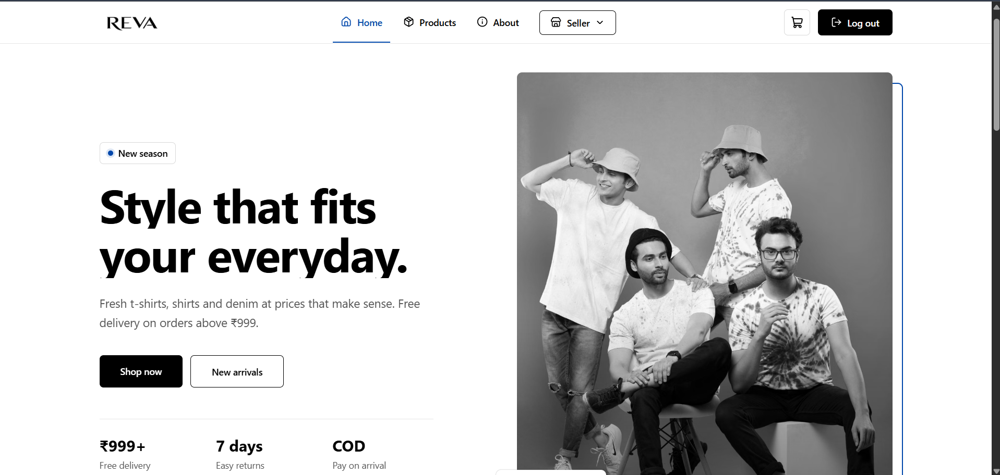
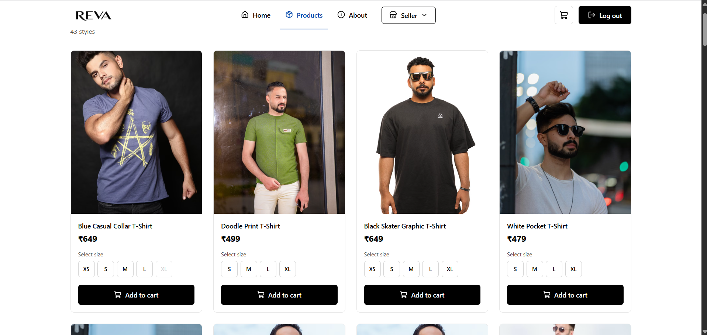
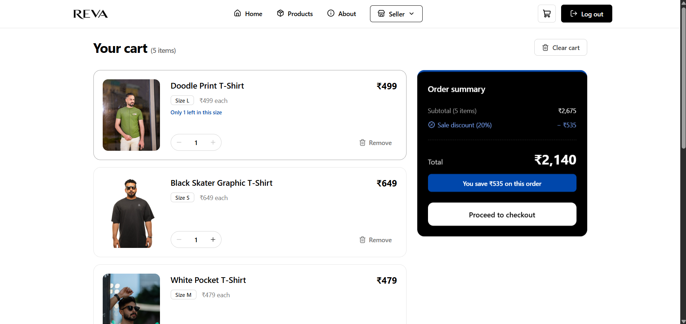
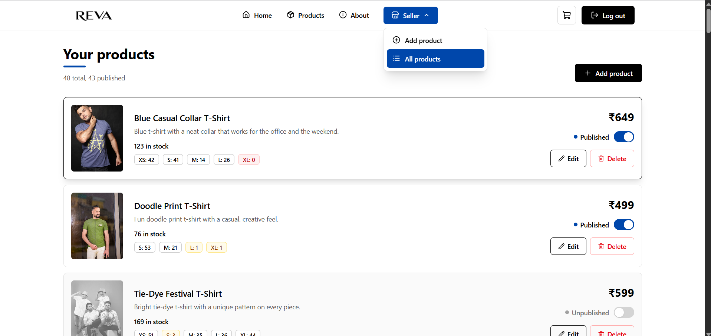

<div align="center">

# REVA

**Everyday clothing at honest prices.**
A full-stack e-commerce app for shoppers and sellers, built with the MERN stack.


</div>

---

## Overview

REVA is a clothing store where customers browse products, pick a size and manage a cart, while sellers list and manage their own products from a dedicated panel. Access is role based: the seller tools only appear for seller accounts and are enforced on the server.

## Screenshots

| Home | Products |
| :---: | :---: |
|  |  |

| Cart | Seller panel |
| :---: | :---: |
|  |  |

## Features

### For customers
- Register, log in and log out securely
- Browse listed products with size and price
- Cart with quantity controls, per item remove and a clear cart option
- Stock aware cart: quantity can never go beyond the stock of the selected size
- Unavailable items (deleted or unlisted products) are flagged in the cart and block checkout until removed
- Order summary with a 20% sale discount and total savings
- Loading skeletons, empty states and clear error messages

### For sellers
- Seller entry in the navbar with a dropdown (Add Product, All Products), visible only to seller accounts
- Add product form with title, description, price, sizes with stock and up to 5 images
- Image upload to ImageKit with preview, type and size validation
- List and unlist products with a single publish toggle
- Seller product list showing stock per size, price and status

## Tech stack

| Layer | Technology |
| --- | --- |
| Frontend | React, React Router, Tailwind CSS, lucide-react |
| State and data | Redux (current user), TanStack React Query (server data), React Hook Form |
| HTTP | Axios |
| Backend | Node.js, Express |
| Database | MongoDB with Mongoose |
| Auth | JWT access token, role based authorization (`customer`, `seller`) |
| Validation | express-validator |
| File upload | Multer and ImageKit |

## Project structure

```text
frontend/
└── src/
    ├── app/
    │   └── layouts/          AuthLayout, MainLayout
    ├── routes/               AppRoute, PublicRoute, PrivateRoute, SellerRoute
    ├── config/               Axios instance
    ├── features/
    │   ├── auth/             api, hook, ui (Login, Register)
    │   ├── cart/             api, hook, ui (CartPage, CartItem, EmptyCart, UnavailableItem)
    │   └── product/          api, hook, ui (Products, AddProduct, SellerProducts)
    └── shared/
        └── ui/               Home, About, Navbar, Footer, loaders

backend/
├── controllers/              auth, cart, product
├── models/                   user, product, cart
├── routes/
├── middlewares/              authenticate, authenticateSeller, upload
└── validators/               express-validator chains
```

## Getting started

### Prerequisites
- Node.js 18 or newer
- A MongoDB database (local or Atlas)
- An ImageKit account for product images

### 1. Clone the repository

```bash
git clone https://github.com/your-username/reva.git
cd reva
```

### 2. Set up the backend

```bash
cd backend
npm install
```

Create a `.env` file in `backend/`:

```env
PORT=3000
MONGO_URI=mongodb://localhost:27017/reva
JWT_SECRET=replace-with-a-long-random-string

IMAGEKIT_PUBLIC_KEY=your_public_key
IMAGEKIT_PRIVATE_KEY=your_private_key
IMAGEKIT_URL_ENDPOINT=https://ik.imagekit.io/your_id
```

Start the server:

```bash
npm run dev
```

The API runs at `http://localhost:3000/api`.

### 3. Set up the frontend

```bash
cd frontend
npm install
npm run dev
```

Make sure the Axios base URL in `src/config` points to `http://localhost:3000/api`.

### 4. Create a seller account

Register a normal account, then change its `role` from `customer` to `seller` in the `users` collection. The Seller menu appears after the next login or page refresh. A self serve "Become a seller" flow is on the roadmap.

## Roles

| Capability | Customer | Seller |
| --- | :---: | :---: |
| Browse listed products | Yes | Yes |
| Use the cart | Yes | Yes |
| Add products | No | Yes |
| List or unlist products | No | Yes |
| Access `/seller/*` pages | No | Yes |

Role checks run on the server in the `authenticate` and `authenticateSeller` middlewares. Hiding the navbar entry is only a convenience, not the security layer.

## API overview

All routes are prefixed with `/api` and require a logged in user unless noted.

### Cart

| Method | Endpoint | Body | Description |
| --- | --- | --- | --- |
| GET | `/cart` | | Get the cart with product details and `availableStock` per item |
| POST | `/cart` | `{ productId, size, quantity }` | Add an item, or increase the quantity of the same product and size |
| PATCH | `/cart/:itemId` | `{ quantity }` | Set the final quantity of one cart item |
| DELETE | `/cart/:itemId` | | Remove one cart item |
| DELETE | `/cart` | | Remove all items |

### Products

| Method | Endpoint | Access | Description |
| --- | --- | --- | --- |
| GET | `/products` | Customer | List published products |
| POST | `/products` | Seller | Create a product (`multipart/form-data`) |
| PATCH | `/products/listing/:id` | Seller | Publish or unpublish a product with `{ published: true \| false }` |

Seller only endpoints also return all, listed and unlisted products for the seller panel.

Creating a product expects these form fields:

| Field | Format |
| --- | --- |
| `title` | text |
| `description` | text |
| `price` | JSON string, for example `{"amount":599,"currency":"INR"}` |
| `sizes` | JSON string, for example `[{"size":"M","stock":50}]` |
| `published` | `true` or `false` |
| `images` | up to 5 files (JPG, PNG or WebP) |

## Data models

```js
Product {
  title: String,
  description: String,
  images: [String],
  price: { amount: Number, currency: "INR" },
  sizes: [{ size: "XS" | "S" | "M" | "L" | "XL" | "XXL", stock: Number }],
  seller: ObjectId,
  published: Boolean
}

Cart {
  user: ObjectId,
  products: [{ product: ObjectId, quantity: Number, size: String }]
}
```

## Business rules

- A cart item is identified by its own `_id`. The same product in two sizes creates two items.
- Adding a product that is already in the cart (same size) increases its quantity instead of duplicating it.
- Quantity is always validated against the stock of the selected size on the server.
- A product that is deleted or unlisted shows as unavailable in the cart and is excluded from totals.
- Every user has exactly one cart.

## Design

A black and white interface with cobalt blue (`#0047AB`) as the single accent color, subtle scroll and entrance animations, and support for reduced motion preferences.

## Roadmap

- [x] Authentication and role based access
- [x] Cart with stock validation and unavailable item handling
- [x] Seller product creation with image upload
- [x] Publish and unpublish products
- [ ] Seller product list with All, Listed and Unlisted tabs
- [ ] Edit and delete products
- [ ] Checkout and orders
- [ ] Self serve "Become a seller" flow
- [ ] Debounced, optimistic quantity updates in the cart

## Contributing

Issues and pull requests are welcome. For larger changes, please open an issue first to discuss what you would like to change.